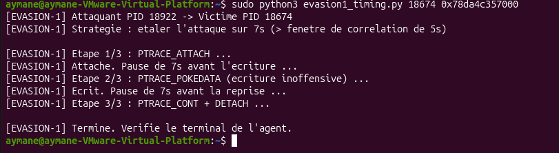
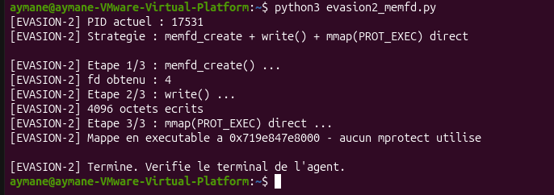
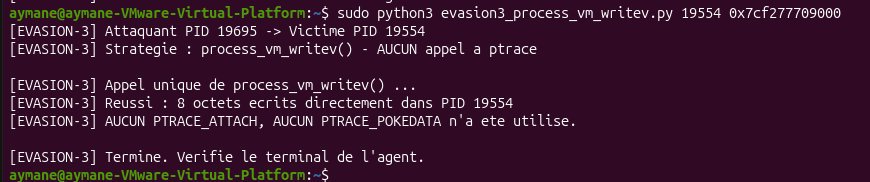
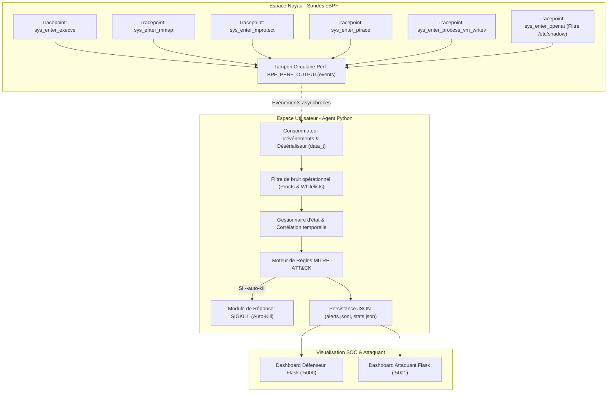

# 🛡️ Linux Kernel EDR Agent via eBPF & BCC — Behavioral Detection & MITRE ATT&CK

<p align="center">
  
  
  
  
  
  
</p>

---

## 📌 Présentation Générale

Ce projet présente la conception, l'implémentation et l'évaluation d'un **Agent de Détection et Réponse sur les Terminaux (EDR)** pour environnements **Linux**, exploitant les technologies d'observabilité noyau **eBPF (Extended Berkeley Packet Filter)** et le framework **BCC (BPF Compiler Collection)**.

Face à la multiplication des menaces furtives opérant en mémoire vive (**fileless malware**), manipulant l'espace d'adressage de processus légitimes (**process injection**) ou détournant des utilitaires natifs du système d'exploitation (**LOLBins**), les solutions de sécurité traditionnelles basées sur les signatures de fichiers disques s'avèrent inopérantes.

Cet agent EDR propose une **architecture hybride noyau/espace utilisateur** capable de :
1. Intercepter à la source les appels système critiques via des sondes eBPF sans altérer la stabilité du noyau.
2. Éliminer le bruit opérationnel inhérent aux systèmes d'exploitation multitâches à l'aide d'un moteur de filtrage contextuel et comportemental.
3. Détecter et corréler en temps réel des scénarios d'attaque avancés et des techniques d'évasion complexes alignés sur le référentiel **MITRE ATT&CK**.
4. Déclencher une remédiation active immédiate (**auto-kill** par signal `SIGKILL`) ou consigner les alertes pour analyse SOC.
5. Visualiser la télémétrie défensive et offensive à travers deux tableaux de bord web interactifs (**Flask**).

---

## 👥 Cadre Académique & Professionnel

| Information | Détails |
|---|---|
| **Établissement** | **EMSI** — École Marocaine des Sciences de l'Ingénieur (4ème année Ingénierie Informatique et Réseaux) |
| **Encadrement Pédagogique** | **Mme. Khadija Bousmar** (EMSI) |
| **Organisme d'Accueil** | **NETSIZE** |
| **Encadrement Professionnel** | **M. Mohamed Ezzamrany** (NETSIZE) |
| **Période** | 15 juillet au 31 août 2026 (Année universitaire 2025–2026) |

---

## 🎯 Chiffres Clés & Métriques d'Évaluation

<p align="center">
  <b>12 835+</b> Événements Noyau Interceptés &nbsp;•&nbsp; 
  <b>7</b> Scénarios d'Attaque & Évasions Couverts &nbsp;•&nbsp; 
  <b>0</b> Faux Positifs en Régime Nominal &nbsp;•&nbsp; 
  <b>100%</b> Détection des Tentatives d'Évasion Mémoire
</p>

---

## 📸 Démonstration Visuelle (Dashboards & Scénarios)

### 1. Tableau de Bord Défenseur (SOC Defender View — Port 5000)
Supervision en temps réel affichant les métriques de santé de l'hôte (CPU / RAM), le volume d'événements interceptés / filtrés, et le flux d'alertes hiérarchisées par sévérité (**CRITIQUE**, **HIGH**, **MEDIUM**) avec recommandations tactiques.
<p align="center">
  
</p>

### 2. Tableau de Bord Attaquant (Dual-View Correlation — Port 5001)
Interface dédiée à l'opérateur offensif en laboratoire permettant de croiser en temps réel les exploits lancés avec leur statut de détection effectif côté EDR.
<p align="center">
  
</p>

### 3. Modes d'Exécution de l'Agent EDR
<p align="center">
  
  
</p>
<p align="center">
  
</p>

### 4. Détection des Attaques en Mémoire (T1055 & Variantes)
<p align="center">
  
  
</p>
<p align="center">
  
  
</p>

### 5. Résilience face aux Techniques d'Évasion Avancées
<p align="center">
  
  
</p>
<p align="center">
  
  
</p>
<p align="center">
  
  
</p>

### 6. Détection LOLBins (T1218) & Vol d'Identifiants (T1003)
<p align="center">
  
  
</p>

---

## 🏛️ Architecture du Système

L'agent repose sur une stricte séparation des responsabilités entre l'espace noyau et l'espace utilisateur :



---

## 🗂️ Structure du Répertoire

```
PROJECT FILES/
├── step9_lolbins_credaccess.py       # Agent EDR principal (eBPF en C + Corrélation Python)
├── dashboard.py                      # Serveur Flask du tableau de bord SOC (Port 5000)
├── attacker_dashboard.py             # Serveur Flask du tableau de bord Attaquant (Port 5001)
├── attacker_log.py                   # Utilitaire de consignation des tentatives offensives
│
├── victim.py                         # Processus leurre allouant une mémoire cible
├── inert_poc.py                      # PoC T1055 : Auto-modification mémoire inerte (mmap + mprotect)
├── attacker_poc.py                   # PoC T1055.008 : Injection inter-processus via ptrace
├── evasion1_timing.py                # PoC T1055.008 : Évasion par désynchronisation temporelle (14s)
├── evasion2_memfd.py                 # PoC T1055.009 : Évasion mémoire fileless (memfd_create)
├── evasion3_process_vm_writev.py     # PoC T1055.012 : Injection directe via process_vm_writev
│
├── edr_agent_logs/                   # Journaux structurés de démonstration
│   ├── alerts.jsonl                  # Flux des alertes qualifiées MITRE
│   └── stats.json                    # Télémétrie et métriques de filtrage
├── agent_output.log                  # Trace textuelle brute d'évaluation
├── requirements.txt                  # Dépendances Python (Flask)
├── .gitignore                        # Configuration d'exclusion Git
└── docs/
    └── screenshots/                  # 22 captures d'écran haute résolution
```

---

## 🎯 Matrice de Détection & Couverture MITRE ATT&CK

| Technique MITRE | Nom de la Menace | Mécanisme de Détection eBPF / Corrélation | Sévérité |
|---|---|---|:---:|
| **T1055** | Process Injection (Self-modification) | Détection d'une séquence `mmap(PROT_WRITE)` suivie d'un passage en `mprotect(PROT_EXEC)` dans une fenêtre temporelle de 3s. | <span style="color:orange">**HIGH**</span> |
| **T1055.008** | Process Injection (ptrace, cross-process) | Suivi d'état acteur/cible : `PTRACE_ATTACH` → écriture `PTRACE_POKEDATA` / `POKETEXT` → reprise `PTRACE_CONT` ou `PTRACE_DETACH`. | <span style="color:orange">**HIGH**</span> |
| **T1055.008 (Variante)** | Timing Evasion (Évasion temporelle) | Suivi contextuel résistant aux pauses artificielles (ex: 14s d'étalement) déjouant les fenêtres de corrélation naïves. | <span style="color:orange">**HIGH**</span> |
| **T1055.009** | Process Injection (Fileless via memfd) | Détection de la création d'un descripteur `memfd_create` couplé à un mapping direct `mmap(PROT_EXEC \| MAP_SHARED)`. | <span style="color:orange">**HIGH**</span> |
| **T1055.012** | Process Injection (Process Hollowing / writev) | Interception de l'appel système `process_vm_writev` ciblant l'espace mémoire d'un PID distinct sans attachement ptrace préalable. | <span style="color:orange">**HIGH**</span> |
| **T1218** | System Binary Proxy Execution (LOLBins) | Interception `execve` d'utilitaires sensibles (`curl`, `wget`, `nc`, `openssl`...) lancés par un parent non interactif (ex: `python3`). | <span style="color:yellow">**MEDIUM**</span> |
| **T1003** | OS Credential Dumping | Filtre noyau sur `openat` avec comparaison bornée de chaînes (`/etc/shadow`, `/etc/gshadow`). Déclenchement prioritaire. | <span style="color:red">**CRITIQUE**</span> |

---

## 🔒 Principes de Sécurité des PoCs

Les preuves de concept développées dans ce projet ont été conçues selon des **exigences de sécurité strictes** :
- **Charges Utiles Inertes** : Les exploits écrivent des chaînes inoffensives en mémoire (ex: séquence d'octets `0x4141414141414141` représentant `'AAAAAAAA'`), sans altération de code système ni exfiltration de données.
- **Environnement Confiné** : Exécution sur machine virtuelle isolée en mode réseau privé (*host-only*), excluant tout risque de propagation.
- **Mode Observation par Défaut** : L'agent consigne les détections avec la mention `NON_APPLIQUE (mode observation seule)`. La neutralisation active (`--auto-kill`) est une option explicite réservée aux tests de remédiation.

---

## 🚀 Guide d'Installation & Démonstration

### 1. Prérequis Système
- **Système d'exploitation** : Ubuntu 22.04 LTS ou 24.04 LTS (Noyau Linux ≥ 5.15 recommandé avec headers installés)
- **Privilèges** : Accès root (`sudo`) requis pour le chargement des programmes eBPF
- **Paquets système requis** :
  ```bash
  sudo apt update
  sudo apt install -y python3 python3-pip linux-headers-$(uname -r) bpfcc-tools python3-bpfcc
  ```
- **Dépendances Python** :
  ```bash
  pip install -r requirements.txt
  ```

---

### 2. Procédure de Démonstration Complète

Pour observer le fonctionnement en temps réel, ouvrez **4 terminaux** :

#### 🔹 Terminal 1 : Lancement de l'Agent EDR
```bash
# Mode observation passive (recommandé pour audit)
sudo python3 step9_lolbins_credaccess.py

# OU avec remédiation active automatique (SIGKILL du processus malveillant)
sudo python3 step9_lolbins_credaccess.py --auto-kill

# Option supplémentaire : --verbose pour afficher l'ensemble des syscalls bruts
```

#### 🔹 Terminal 2 : Tableau de Bord Défenseur (SOC)
```bash
python3 dashboard.py
```
> Ouvrez votre navigateur sur **http://localhost:5000** pour suivre les alertes de sécurité.

#### 🔹 Terminal 3 : Tableau de Bord Attaquant
```bash
python3 attacker_dashboard.py
```
> Ouvrez votre navigateur sur **http://localhost:5001** pour comparer les tentatives offensives et leur détection.

#### 🔹 Terminal 4 : Exécution des Scénarios Offensifs

1. **Auto-Modification Mémoire (T1055)** :
   ```bash
   python3 inert_poc.py
   ```

2. **Évasion Mémoire Fileless memfd (T1055.009)** :
   ```bash
   python3 evasion2_memfd.py
   ```

3. **Abus de LOLBins (T1218)** :
   ```bash
   python3 -c "import subprocess; subprocess.run(['curl', '--version'])"
   ```

4. **Tentative d'accès aux identifiants (T1003)** :
   ```bash
   sudo cat /etc/shadow > /dev/null
   ```

5. **Injection Inter-Processus (T1055.008)** :
   ```bash
   # Lancer d'abord le processus leurre
   python3 victim.py
   # Le script affiche son PID et l'adresse mémoire allouée (ex: PID 17944, Addr 0x72e75d0a3000)
   
   # Dans un autre terminal (ou après mise en arrière-plan) :
   sudo python3 attacker_poc.py <PID> <ADRESSE_HEX>
   ```

6. **Évasion Temporelle (T1055.008 / Timing)** :
   ```bash
   python3 victim.py
   sudo python3 evasion1_timing.py <PID> <ADRESSE_HEX>
   ```

7. **Évasion Directe via process_vm_writev (T1055.012)** :
   ```bash
   python3 victim.py
   sudo python3 evasion3_process_vm_writev.py <PID> <ADRESSE_HEX>
   ```

---

## 🛠️ Format des Alertes JSON (`alerts.jsonl`)

Chaque détection est journalisée au format JSON structuré, prête pour ingestion par une plateforme SIEM :

```json
{
  "timestamp": 1788451865.016,
  "datetime": "2026-09-03 17:11:05",
  "mitre_id": "T1055.008",
  "mitre_name": "Process Injection (ptrace, cross-process)",
  "actor_pid": 8255,
  "actor_process": "python3",
  "target_pid": 8175,
  "target_process": "python3",
  "extra_info": "duree totale 14.05s",
  "severity": "HIGH",
  "description_fr": "Le processus « python3 » (PID 8255) s'est attache au processus PID 8175, y a ecrit des donnees, puis a repris son execution, en 14.05s au total.",
  "response_action": "NON_APPLIQUE (mode observation seule)"
}
```

---

## 🔮 Limitations & Perspectives d'Évolution

- **Migration vers `libbpf` & CO-RE** : Remplacement de BCC par `libbpf` avec *Compile Once – Run Everywhere* (CO-RE) et utilisation native de `BPF_MAP_TYPE_RINGBUF` pour réduire la consommation mémoire.
- **Enrichissement Machine Learning** : Compléter les règles déterministes par des modèles d'apprentissage non supervisé pour déceler des anomalies comportementales complexes et des menaces polymorphes.
- **Surveillance Réseau eBPF** : Intégration de hooks TC (*Traffic Control*) et XDP pour corréler les altérations mémoire avec les flux réseau sortants (C2, exfiltration).
- **Déploiement Distribué** : Centralisation des alertes via Kafka/Elasticsearch pour une supervision multi-nœuds en environnement conteneurisé (Kubernetes).

---

## 📄 Licence

Ce projet est distribué sous licence **MIT**. Libre d'utilisation et d'adaptation dans le cadre de recherches académiques ou de travaux en sécurité des systèmes.
